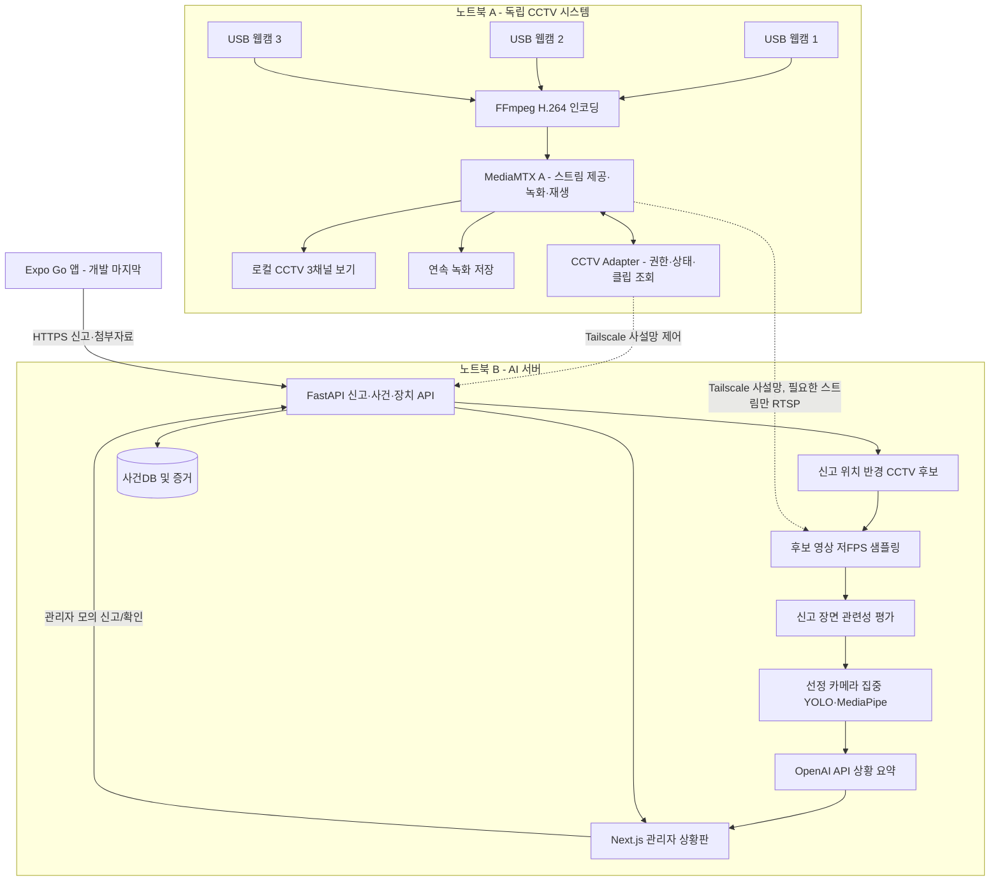

# 시민 신고 기반 CCTV 선택적 AI 영상 분석 및 실시간 상황 대응 지원 시스템

> **2026 PKNU AI·SW 부우산☂ 지역문제 발굴 대회 — 전시용 프로젝트 상세 개발계획서**  
> 문서 버전: **v2.0 / 2026-10-22**  
> 문서 성격: **구현 설계·개발 작업 기준서** — 실제 구현·검증이 끝났다는 의미가 아니다.  
> 과제명: **시민 신고 기반 CCTV 선택적 AI 영상 분석 및 실시간 상황 대응 지원 시스템**  
> 시연 환경: Windows CCTV 노트북 A(USB 웹캠 **3대**), Windows AI 서버 노트북 B(**NVIDIA RTX 3060 Laptop GPU**), 스마트폰(마지막에 **Expo Go** 앱), 관리자 **Next.js** 화면.

---

## 0. 프로젝트 최종 결정 사항: 이 문서가 우선한다

이전 대화에서 변경된 사항을 다음과 같이 **최종 반영**한다.

1. **먼저 실제 CCTV와 유사한 독립 녹화시스템을 만든다.** 노트북 A에서 웹캠 3대를 영상 채널로 등록하고, 24시간 녹화가 가능한 구조(전시 시에는 가동 중 연속 녹화), 실시간 보기, 과거 영상 검색, 녹화 저장·재생을 구현한다.
2. **AI 기능은 독립된 추가 소프트웨어로 구현한다.** CCTV 시스템은 AI를 설치하지 않아도 단독으로 작동해야 한다. 기존 IP CCTV·NVR·VMS에도 연결 가능한 **CCTV 연동 어댑터(Adapter)**를 구분하여 개발한다.
3. **서버 노트북 B가 모든 AI 분석을 수행한다.** 노트북 A는 캡처·영상 인코딩·녹화·송출·영상 구간 제공과 상태 보고만 담당한다. B는 신고 분류, 관련 CCTV 탐색, YOLO·MediaPipe, OpenAI API 호출, 상황 보고서, 관리자 웹과 DB를 담당한다.
4. **같은 Wi-Fi는 필요하지 않다.** A와 B는 서로 다른 인터넷 회선에서 **Tailscale 사설망 + RTSP**로 연결한다. 스마트폰 신고는 별도 **인증된 HTTPS** 경로로 서버 B에 접근한다.
5. **촬영 방향을 일일이 미리 등록하지 않는다.** 신고 위치를 중심으로 검색 반경을 만들고, 그 안의 접근 가능한 CCTV 영상에서 **신고 관련 장면을 저비용 AI 탐색**한 뒤 관련성이 높은 카메라만 집중 분석한다. CCTV 위치정보만으로 정확한 촬영 장면이나 신고자의 신원을 확정할 수는 없다.
6. **신고 앱에 상세 위치·사진·영상·녹음 기능을 넣는다.** 실내라면 건물명·층수·출입구·주변 표지 등을 적을 수 있고, 앱이 첨부한 자료는 신고자의 직접 선택을 받아 상황 확인의 보조 정보로 사용한다.
7. **관리자 화면은 Next.js**(React·TypeScript·Tailwind)다. 맵에 실제 공개 CCTV 위치정보를 표시하며, 전시장 웹캠 기반 **실제 영상 분석 가능한 데모 CCTV**를 별도 레이어로 구분한다.
8. **Expo Go 신고 앱은 개발의 가장 마지막 단계**에서 제작한다. 먼저 Next.js 관리자의 '모의 신고'로 전체 분석 파이프라인을 검증한다.
9. **긴급 신고를 AI가 지연시키지 않는다.** AI는 확인·분석 보조 도구이며, 112·119 연동 및 기관 영상 전송은 정식 승인과 계약·보안 연동 이전에는 구현하지 않는다.
10. **현재 개발·시연의 영상 입력은 웹캠 3대만 사용한다.** 실제 공공 CCTV는 공개 좌표를 지도·목록에 표시하는 용도로만 사용하고 AI 학습·분석·영상 보존에서 제외한다. A의 `cam-01`(내장), `cam-02`, `cam-03`(USB)만 시연 영상 입력으로 허용한다. 이후 어댑터 확장 설명보다 이 현재 범위 제한이 우선한다.

**핵심 시연 문장:** "기존 CCTV 녹화시스템을 그대로 유지한 상태에서, 시민 신고가 들어올 때만 주변 CCTV 후보를 검색하고 필요한 영상에 AI 분석을 집중하는 소프트웨어를 추가했습니다."

---

## 1. 대회 공식 자료 확인

### 1.1 대회 개요 — 첨부된 공식 계획(안) 기준

| 항목                   | 공식 문서에 기재된 내용                                                        |
| ---------------------- | ------------------------------------------------------------------------------ |
| 대회명                 | **2026 PKNU AI·SW 부우산☂ 지역문제 발굴 대회(고교 대상)**                      |
| 주관                   | 국립부경대학교 소프트웨어융합혁신원                                            |
| 주최                   | 과학기술정보통신부, 정보통신기획평가원(IITP), 부산광역시(인공지능소프트웨어과) |
| 주제                   | **AI·SW를 활용한 부산 지역 문제 발굴 및 해결**                                 |
| 참가 대상              | 부산 소재 고등학교 재학생 **2~5명**으로 구성된 팀, 팀별 지도교사 **1명**       |
| 참가 규모              | 약 **10개 팀**                                                                 |
| 장소                   | **국립부경대학교 대연캠퍼스 컨벤션홀 다목적홀**                                |
| 행사일                 | **2026-12-02(수)**                                                             |
| 참가 등록              | **11:00~12:00**                                                                |
| 작품 전시·발표 및 심사 | **13:00~16:00**                                                                |
| 심사 기준              | 문제 발굴의 적절성, 창의성, AI·SW 활용성, 실현 가능성, 기대 효과               |
| 전시 장비              | 개별 시연 장비는 팀이 지참. 전원·인터넷 지원은 사전 수요조사 결과 확인 필요    |

### 1.2 공식 일정과 현재 확인해야 할 사항

| 공식 일정               | 날짜                        | 비고                                                                |
| ----------------------- | --------------------------- | ------------------------------------------------------------------- |
| 참가 모집               | **2026-08-24 ~ 2026-10-16** | 현재 기준 종료된 일정                                               |
| 선정 발표               | **2026-10-21 예정**         | **실제 팀 선정 여부는 확인하지 못함**. 학교/주최기관 안내 확인 필요 |
| 2차 조사 및 출품작 제출 | **2026-10-22 ~ 2026-11-13** | 실제 선정팀에 별도 안내되는 세부 제출 조건을 우선 적용              |
| 전시 패널·운영물품 준비 | **2026-11-16 ~ 2026-12-01** | 프로젝트 시연 안정화, 패널 제작 기간                                |
| 본선                    | **2026-12-02**              | 등록 11:00~, 심사 13:00~16:00                                       |

- 공식 문서의 '행사 진행 11:00~18:30'은 **11시 참가 등록부터**를 포함한다. 전시·심사 시간은 계획안의 세부표에 있는 **13:00~16:00**으로 구분한다.
- 시상 계획(변경 가능): 최우수상 1팀 60만 원, 우수상 1팀 50만 원, 장려상 3팀 각 30만 원, 창의상 5팀 각 20만 원, 총 300만 원.
- 대회 측 실제 참가 선정, 최종 제출형식, 전원 콘센트·인터넷 제공 여부는 **주최 측 공지/담당자**가 우선한다. 이 계획서는 접수/선정 완료를 보증하지 않는다.
- 참가 양식은 **제1호 신청서, 제2호 과제 세부 계획서, 제3호 참가학생별 개인정보 동의서**로 구성되어 있다. 개인정보 동의서 작성·서명은 참여자 각자가 직접 수행한다.

### 1.3 심사기준과 우리 작품의 연결

| 심사항목      | 전시에서 입증할 근거                                                                             |
| ------------- | ------------------------------------------------------------------------------------------------ |
| 지역문제 발견 | 부산에서 대규모 CCTV 운영 시 시민 신고를 관제에 반영할 필요성; 공식 자료·현장 조사와 문제 정의   |
| 창의성        | **독립 녹화 CCTV + 추가 AI 어댑터**, 신고 기반 후보 선별, 첨부자료 통합, 분석 실패의 명시        |
| AI·SW 활용    | YOLO, MediaPipe, 신고 분류 및 멀티모달 상황 요약, CCTV 선택 알고리즘, 원격 영상 통신             |
| 실현 가능성   | **USB 웹캠 3대가 실제로 녹화·재생**되고 추가 프로그램이 신고 관련 영상만 읽어 분석하는 작동 시연 |
| 기대 효과     | 전체 분석과 신고 기반 분석의 영상 처리량·지연·성공률 비교 데이터; 오탐·미탐도 공개               |

### 1.4 공식 첨부자료

- 첨부 PDF: **「2026 PKNU AI·SW 부우산☂ 지역문제 발굴 대회(고교 대상) 계획(안)」, 총 4페이지**.
- 첨부 문서: **국립부경대학교 대회 안내 및 참여 협조 요청**.
- 첨부 HWP: **지역현안 Capstone Design 신청서 / 과제 세부 계획서 / 개인정보 수집·이용 동의서**.
- 이 절의 날짜·모집 규모·심사·행사 내용은 위 첨부자료에서 확인한 값이다. 이하 개발 기술과 구현 방법은 **우리 팀의 설계 제안**이며 주최기관이 정한 필수 구현 규격이 아니다.

---

## 2. 사용자 문제 및 제품 범위

### 2.1 해결하려는 문제

- 많은 CCTV 영상을 항상 고비용 AI로 분석하기에는 연산 자원과 운영비 부담이 있을 수 있다.
- 영상만으로는 시민이 실제로 겪고 신고한 문제의 맥락을 알기 어렵다.
- 신고 장소 근처에 여러 카메라가 있어도 어느 카메라가 사건을 촬영하는지 즉시 알기 어렵다.
- 시민이 설명한 상황과 현장 영상이 다를 수 있고, 실내·지하·건물 내부는 GPS 오차와 CCTV 사각지대가 존재한다.
- 실시간 장면뿐 아니라 **신고 발생 전후에 녹화된 영상**도 필요할 수 있다.

### 2.2 기능 범위

**반드시 동작해야 하는 MVP**

1. 웹캠 3대가 노트북 A에서 상시 수집·녹화되고, 각 채널의 현재 영상과 이전 녹화 영상을 재생할 수 있다.
2. AI 프로그램을 중지해도 CCTV 녹화가 정상 유지된다.
3. 관리자가 Next.js 지도에서 실제 공개 CCTV 위치와 데모 CCTV 3대를 구별해 볼 수 있다.
4. 신고(초기에는 관리자 모의 신고)에 텍스트·GPS/상세 위치·시각·첨부자료를 입력할 수 있다.
5. 신고 위치 중심의 검색 범위 내 CCTV 목록을 생성하고, 후보 영상에서 사건 관련 장면을 검색한다.
6. 가장 관련성이 높은 채널에 YOLO·MediaPipe 집중 분석을 적용한다.
7. CCTV 영상 + 사용자가 동의하여 올린 사진/녹음의 관찰 결과를 종합해 불확실성을 표시한다.
8. 관리자에게 영상 클립, 사건 시각, 분석 근거, 확인 불가 사유, 영상 보존 기록을 제공한다.
9. 같은 조건에서 **전체 CCTV 분석 vs 신고 기반 선택 분석**을 비교한다.
10. 앱 개발 마지막에 Expo Go에서 신고·사진·짧은 영상·녹음 업로드를 연결한다.

**2차 확장(시간이 남을 경우)**

- 신고가 여러 건일 때 분석 큐와 중복 카메라 분석 공유.
- 관심 화면의 자동 전환과 실시간 상황 변화 재알림.
- 포트홀 등 별도의 데이터셋과 학습이 필요한 영상 모델.
- 공공시설 보수·점검 요청서 초안 자동 작성(시설의 실제 보수 방법·비용은 현장 확인 후 결정).
- 정식 기관과 협약한 실제 CCTV/NVR 데이터 연결.

**MVP 제외**

- 승인되지 않은 공공·사설 CCTV 원본 스트림 접속 또는 추측한 주소 수집.
- 영상만으로 범죄자·흡연 위반·질병·부상 상태를 자동 확정하는 기능.
- 특정인을 얼굴인식으로 신원 식별하거나 카메라 사이에서 개인을 추적하는 기능.
- 실제 경찰·소방으로 자동 영상 전송, 자동 출동 요청·취소.
- Expo Go에서 장시간 백그라운드 카메라·마이크 스트리밍 보장.

---

## 3. 장비·소프트웨어 책임 분리

| 영역              | 장비                                           | 주요 책임                                                              | AI 실행 여부  |
| ----------------- | ---------------------------------------------- | ---------------------------------------------------------------------- | ------------- |
| **CCTV/NVR 역할** | **노트북 A**, Windows, USB 웹캠 3대            | 캡처·인코딩·녹화·보관·재생·RTSP 제공·접속 상태                         | **아니오**    |
| **AI 관제 서버**  | **노트북 B**, Windows, **RTX 3060 Laptop GPU** | 카메라 후보 검색·영상 선택·YOLO/MediaPipe·OpenAI API·DB·Next.js·업로드 | **예**        |
| 신고자            | 스마트폰                                       | 신고·상세 위치·선택적 촬영/녹음/전송                                   | 아니오        |
| 전시 관리자       | 노트북 B 또는 별도 브라우저                    | 지도·신고 수신·분석 실행·영상 검토·보존·종결                           | 아니오(웹 UI) |

### 3.1 노트북 A — 독립 CCTV 시스템(CCTV Base)

- **FFmpeg (Windows DirectShow)**: USB 웹캠을 각각 독립 채널로 입력, H.264로 인코딩.
- **MediaMTX (A에서 실행)**: 각 채널 스트림 수신·로컬 재생·녹화·녹화된 영상 재생 제공.
- **로컬 CCTV 관리 화면/도구**: 3채널 상태, 현재 화면 확인, 저장 경로·용량·보존기간, 과거 영상 재생, 장치 장애 표시.
- A에 YOLO, MediaPipe, ChatGPT API 및 신고 분류 기능을 설치하지 않는다.
- B가 연결되지 않아도 A의 CCTV 녹화·과거 영상 재생은 정상 동작해야 한다.
- 초기에는 웹캠 3대를 사용하되, 동일한 영상 소스 등록 인터페이스로 기존 RTSP IP 카메라·지원 NVR 입력을 받을 수 있도록 한다.

### 3.2 노트북 A — 추가 소프트웨어(CCTV Bridge/Adapter)

**기존 CCTV 시스템 위에 덧붙이는 분리 가능한 경량 프로그램**이다.

- 등록된 카메라 정보/상태 조회: `list_cameras`, `health`.
- 서버 B가 요청할 때에만 지정 카메라의 스트림 **접근 정보를 제공**하거나 네트워크 중계.
- 원본 영상/녹화 구간을 허가된 사용자에게만 제공: `get_stream`, `get_recording_range`.
- 기록 반출 이력·오류 로그·카메라 접속 권한 기록.
- A의 MediaMTX를 교체하거나 영상파일을 AI 전용 포맷으로 바꾸지 않아야 한다.
- 기존 CCTV 운영 환경에서는 **제조사/관제센터에서 허용하는 영상 출력 인터페이스**를 사용해야 하며 모든 장치가 자동 호환된다고 주장하지 않는다.

**중요한 구현 결정:** **상시 녹화와 원격 AI 분석은 서로 독립**이다. A는 3채널을 로컬에서 계속 녹화하지만, B는 **신고에 필요한 카메라의 프레임/스트림만 VPN으로 가져와 추론**한다. 따라서 A의 로컬 녹화량을 줄이는 설계가 아니라 **B의 AI 처리량과 A↔B 원격 전송량을 선택적으로 줄이는 설계**다.

### 3.3 노트북 B — 중앙 AI 분석 및 관리자 서비스

- Python 3.11 계열, FastAPI, Pydantic, SQLite(데모) / PostgreSQL(확장).
- PyTorch + CUDA + YOLO 객체 탐지.
- MediaPipe Pose Landmarker(자세·동작), 필요 시 Face Landmarker(얼굴 위치·특징점; 개인 식별 기능 없음).
- OpenCV(영상 프레임 추출, 전처리, 이미지 저장, 시간 동기화).
- OpenAI API(신고 텍스트 분류, 사용자가 올린 음성의 전사, 선별 이미지+객체 분석 메타데이터로 상황 요약).
- Next.js(App Router) + TypeScript + Tailwind CSS + Leaflet: 관리자 지도·영상·사건 화면.
- WebSocket: 분석 상황 갱신. 사용자·관리자·CCTV 에이전트의 권한을 분리한다.

### 3.4 개발 사양 검사

노트북 B는 RTX 3060 Laptop GPU가 있지만 **GPU 메모리 용량·TGP·드라이버·CUDA 동작 여부는 실행 검증 전에는 확정하지 않는다**.

```powershell
nvidia-smi
python -c "import torch; print(torch.cuda.is_available())"
```

- 우선 가벼운 YOLO 모델·낮은 프레임 샘플링으로 시작한다.
- MediaPipe 일부 작업은 CPU에서 수행될 수 있으므로 자원 사용량을 실제로 기록한다.
- 세 카메라의 USB 포트·허브 전원·전송 대역폭을 확인하고 **카메라명이 중복될 때의 식별 방법**을 시험한다.

---

## 4. 전체 데이터·네트워크 구조



### 4.1 두 종류의 네트워크 연결

| 연결 구간          | 기술                                               | 공개 범위                                                            |
| ------------------ | -------------------------------------------------- | -------------------------------------------------------------------- |
| A↔B 영상·장치 제어 | **Tailscale VPN + RTSP over TCP + HTTPS 제어 API** | **사설 네트워크 전용**. 원본 RTSP를 일반 인터넷에 직접 공개하지 않음 |
| 스마트폰→B 신고    | **인증된 HTTPS REST 업로드**                       | 인터넷에서 접근 가능한 **신고 전용** 경로만 공개                     |
| 관리자→B           | HTTPS 또는 로컬·승인된 VPN, WebSocket              | 관리자 로그인 후 허용                                                |
| B→OpenAI API       | HTTPS                                              | 필요한 텍스트·허용된 증거만 전송                                     |

- Tailscale 연결은 **직접 P2P 또는 중계**가 될 수 있다. 중계에서는 속도·지연·가용 대역폭을 측정하고 필요시 해상도·비트레이트를 낮춘다.
- 웹브라우저에서 RTSP를 직접 재생하는 대신 **승인된 스트림에 한해 MediaMTX의 HLS/WebRTC 변환 또는 서버 중계**를 사용한다.
- Expo의 개발용 터널은 실제 신고 API를 외부 공개하는 기능을 대체하지 않는다.

### 4.2 녹화 설계

| 항목            | 초기 정책 제안                                                  | 확인할 점                         |
| --------------- | --------------------------------------------------------------- | --------------------------------- |
| 저장 위치       | 노트북 A의 전용 `recordings/` 폴더                              | 디스크 용량·쓰기 권한             |
| 저장 형식       | MediaMTX 지원 분할 녹화(fMP4 등)                                | 실제 기록·재생 지원 형식 검사     |
| 예비 해상도     | 720p, 10~15fps                                                  | USB 웹캠 품질/연산량              |
| 예비 비트레이트 | 카메라당 약 1.5Mbps                                             | 현장 화질과 저장량 실측           |
| 녹화 시간       | 시연 중 연속 녹화, 롤링 보존 기한은 테스트용으로 짧게 설정      | 본선에서는 전원 차단 시 복구 검증 |
| 시간정보        | UTC ISO-8601 + 로컬 표시(Asia/Seoul)                            | A/B/휴대폰 시계 동기화            |
| 사건 보존       | 신고 시간 전후 설정된 구간을 별도 사건 폴더로 복사 및 해시 계산 | 원본과 AI 생성본 구분             |

**저장공간 산정 예시(추정):** 3채널 × 1.5Mbps = 4.5Mbps → 약 **48.6GB/24시간**(오디오·컨테이너 부가 용량 제외). 전시에서 4시간 녹화하면 약 **8.1GB** 수준. 이것은 측정값이 아니므로 실제 압축률에 따라 다를 수 있다.

### 4.3 장치가 일부 고장 났을 때

- A의 인터넷이 끊겨도 로컬 녹화 유지 → 복구 후 관리 화면에 장애 시간 표시.
- B의 AI 서버가 멈춰도 A의 원본 영상 녹화 유지.
- A에서 카메라가 분리되면 해당 채널만 `OFFLINE`, 나머지 채널 녹화 계속.
- 녹화 파일이 없거나 덮어쓰였다면 `RECORDING_UNAVAILABLE`을 반환하고 **없는 영상을 생성했다고 표시하지 않는다**.
- 앱 업로드 실패 시 사용자에게 실패를 표시하고 재시도할 수 있도록 하며, 처리 완료로 오인하지 않도록 한다.

---

## 5. 전시장 관리자 화면 중심의 사용자 경험

### 5.1 지도 레이어 2종

**A. 실제 공개 CCTV 위치 레이어**

- 출처 및 이용 조건을 확인할 수 있는 공공 CCTV *위치 메타데이터*만 지도에 표시.
- 위치 좌표, 운영기관, 영상 접근 가능 여부·미확인 여부·점검 시각을 구별한다.
- 공개된 좌표가 있다는 사실만으로 **그 카메라의 원본 영상 분석 권한이 생기지는 않는다**.
- 영상 연결 권한이 없는 실제 CCTV는 지도에 표시만 하고, 자동 분석 목록에서는 제외한다.

**B. 전시 데모 CCTV 레이어**

- 웹캠 `cam_01`, `cam_02`, `cam_03`을 **운영 중인 데모 영상 채널**로 표시.
- 카메라 3대가 서로 다른 방향을 바라보도록 전시장에 설치한다.
- 영상 스트림의 실제 동작 여부, 녹화 여부, 영상 샘플링 상태를 표시한다.
- 전시장 실내 GPS는 오차가 크므로 **QR 구역표시·지도에서 사건 위치 선택·상세 위치 텍스트**를 보조한다.
- 지도에서 전시장 데모 영역은 별도의 로컬 좌표(예: 2D 부스 구역)나 명시적 '가상 시연 지점'으로 표현한다. 실제 공공 CCTV의 위치를 변경·가짜 표시해서는 안 된다.

### 5.2 신고 접수 후 관리자 화면에 보일 것

1. 신고 번호, 접수 시각, 신고 문장, 분류 유형.
2. GPS 좌표 + 지도에서 지정한 사건 지점 + 건물명·층수·출입구·주변 표지.
3. 후보 CCTV의 위치와 선택 이유(예: 거리, 연결 상태, 영상 속 사람 탐지와 관련성).
4. **후보 전체의 저비용 탐색 진행률**과 우선 집중 분석하는 CCTV.
5. 선택된 CCTV의 현재 영상 및 신고 전후 녹화 영상 클립.
6. 신고자가 자발적으로 제공한 사진·영상·음성 전사(있는 경우).
7. YOLO 객체·자세 검출 결과, 사건 요약, 미확인 정보, AI의 불확실성.
8. 담당자 버튼: `원본 확인`, `추가 영상 탐색`, `사건 영상 보존`, `확인 완료`, `종결`.

### 5.3 관리자 조작 없이도 전체 흐름을 보여줄 모의 신고

앱이 완성되기 전 Next.js 관리자가 **데모 신고 입력** 버튼으로 `POST /reports/demo`를 호출한다. 이 요청은 나중에 Expo 앱에서 사용하는 동일한 신고 파이프라인으로 연결한다.

---

## 6. 신고 기반 CCTV 자동 선택: 새 핵심 알고리즘

### 6.1 입력 자료

| 입력                                       | 출처           | 반드시 필요한지         |
| ------------------------------------------ | -------------- | ----------------------- |
| 신고 위치(위도·경도) 또는 관리자 지정 좌표 | GPS/지도       | 최소 하나 필요          |
| 상세 위치 텍스트(건물·층·입구·방향·표지)   | 신고자         | 선택, 실내에 매우 유용  |
| 신고 내용, 접수 시각, 사건 발생 추정 시간  | 시민 앱/관리자 | 내용과 접수 시각은 필수 |
| 사진·짧은 영상·음성 녹음                   | 신고자 동의    | 선택                    |
| 승인된 CCTV 좌표 및 연결 가능 여부         | 카메라 등록 DB | 후보 생성에 필요        |
| 실시간 영상 및 사고 전후 녹화 영상         | A/NVR/카메라   | 분석을 수행할 때 필요   |

### 6.2 탐색 절차

```text
신고 접수
  ↓
위치 정규화(GPS + 상세 위치 + 수동 수정)
  ↓
기본 반경 R 설정(시연 기본값 예: 100m; 장소/밀도에 맞게 변경)
  ↓
반경 내 등록·접근 승인 CCTV 후보 수집
  ↓
필요한 경우 R을 점진적으로 확대(예: 100 → 200 → 300m, 최대 검색 예산 설정)
  ↓
각 후보에서 낮은 FPS/축소 프레임·녹화 시간대 분석
  ↓
YOLO·MediaPipe 등으로 신고 대상이 나타나는지 탐색
  ↓
신고 시간·유형·사진과 맞는 장면에 관련성 점수 부여
  ↓
상위 1~2개 카메라에서 고빈도 연속 분석 + 사건 구간 보존
  ↓
관리자에게 관련 장면·근거·불확실성 전달
```

**반경 기반 후보 탐색에 촬영 방향 사전 등록은 필수 조건이 아니다.** 카메라 좌표·접근 가능 여부를 먼저 사용한다. 카메라 방향·장애물 정보가 있으면 보조점수로만 활용하며, 없어도 영상 내용 기반 선택이 작동한다.

### 6.3 '신고자의 위치를 특정한다'는 표현의 정확한 의미

- GPS는 휴대폰이 신고 시점에 측정한 **대략적인 위치**다. 이는 사건 장소와 같지 않을 수 있다.
- CCTV 영상은 신고 내용과 관련된 장면을 발견할 수 있지만, 그것만으로 신고자의 **정확한 지도 좌표·신원**을 확인하는 것은 일반적으로 불가능하다.
- 신고 사진에 건물 표지·장면 단서가 있는 경우 사건과 같은 환경인지 **검토할 후보**가 될 수 있다. CCTV 시야 밖이라면 `NOT_VISIBLE`이 정답이다.
- 기본 목표는 **관련 사건을 촬영한 CCTV 탐색**이지 사람 신원 식별·추적이 아니다.

### 6.4 간단한 관련성 점수(초기안)

실험 단계에서 아래처럼 정규화된 값으로 후보를 정렬할 수 있다.

```text
score(camera, report) =
  0.20 * proximity_score
+ 0.15 * time_match_score
+ 0.45 * event_detection_score
+ 0.20 * attachment_context_score
```

- 각 점수는 0~1 범위; 가중치는 **초기 가정값**이며 성능 실험 후 조정한다.
- 사진이 없으면 해당 항목을 0으로 두기보다는 사용 가능한 항목의 가중치를 재정규화한다.
- 사건이 명확히 검출되지 않으면 거리가 가까운 CCTV라는 이유만으로 '확인됨'으로 표시하지 않는다.
- 관련성 점수는 검색 순위이지 사건 사실의 법적·의학적 판단이 아니다.

### 6.5 검색 부하 제어

- 후보는 우선 **저FPS**(예: 카메라당 0.5~1fps, 실험 기본값)로 탐색.
- 관련성 높은 카메라 1~2대는 **집중 분석**(예: 3~5fps, GPU 성능에 따라 조정).
- 실시간 영상 외에도 신고 전후 저장 영상에서 재탐색.
- 동일 카메라·모델을 여러 신고가 동시에 필요로 하면 분석 결과 공유.
- 카메라가 많거나 탐색 반경이 크면 후보 수·탐색시간·프레임 예산에 상한 적용.

**중요한 비용 정의:** 후보 5대의 저FPS 영상까지 읽는 과정은 CPU·네트워크·디코딩 비용이 든다. 따라서 '선택적 AI'라는 이유만으로 모든 컴퓨팅/전송 비용이 자동 감소한다고 주장하지 않고 **실측**한다.

### 6.6 신고 상황 모델 선택

| 신고 유형          | 후보 탐색             | 집중 분석                              | 제한 사항                                  |
| ------------------ | --------------------- | -------------------------------------- | ------------------------------------------ |
| **쓰러짐 의심**    | YOLO 사람/자세 후보   | YOLO 사람 + MediaPipe Pose + 시간 지속 | 실신/호흡/심정지 확정 불가                 |
| **차량 통행 장애** | YOLO 차량 후보        | 차량 추적·정지 시간·관리자 지정 구역   | 실제 불법 주정차 판정 아님                 |
| 방치 물체          | 일반 물체/프레임 변화 | 특정 물체·지속 시간                    | 모델이 학습하지 않은 쓰레기 일반 탐지 불가 |
| 포트홀             | 영상·수동 확인        | 별도 학습 모델(확장)                   | 일반 YOLO가 포트홀을 곧바로 탐지하지 않음  |
| 금연구역 흡연      | 신고 시각의 영상 후보 | 별도 모델/사람 검토(확장)              | 흡연 여부·규정 위반 확정 어려움            |

---

## 7. AI 엔진 및 신고자 자료 종합

### 7.1 서버 B의 영상 처리 흐름

```text
실시간/녹화 영상 디코딩
  → 입력 시간 정보와 카메라 ID 기록
  → FPS 제한 및 프레임 축소
  → YOLO 객체 탐지
  → 해당 객체/사람 ROI에서 MediaPipe Pose 선택 실행
  → 프레임 간 위치·시간 변화 계산
  → 의심 장면 후보 및 근거 프레임 저장
  → 필요한 장면만 OpenAI 이미지 분석 요청
  → 구조화된 사건 요약 생성
  → 관리자 WebSocket 업데이트
```

- **YOLO:** 사람·차량 등 학습된 객체 탐지. 크기·거리·가림에 따른 오탐·미탐 가능.
- **MediaPipe Pose:** 관절 위치·자세 변화. '누워 있음'과 '위급함'은 동일하지 않음.
- **MediaPipe Face:** 필요한 경우 얼굴 **영역·특징점**만 분석. 신원 추정·감정·범죄성 판단에 사용하지 않음.
- **OpenAI API:** 신고 문장 구조화, 사용자 제공 녹음의 음성 전사, 선별 이미지/탐지 메타데이터를 토대로 관리자용 설명 생성.
- 영상 전체를 매 프레임 API로 보내지 않는다. 호출 비용·지연·개인정보 노출을 줄이기 위해 **로컬 객체 탐지 → 중요 프레임 선별 → 제한적 API 호출** 순서를 적용한다.

### 7.2 신고자 자료 결합

| 자료           | 서버 처리                      | 상황 보고서에서 다룰 방식                               |
| -------------- | ------------------------------ | ------------------------------------------------------- |
| 신고 텍스트    | 사건 유형·장소 단서 추출       | `reporter_claim` — 신고자 설명                          |
| 스마트폰 사진  | 사용자가 업로드한 사진만 분석  | `phone_photo_observation` — 이미지에서 직접 관찰한 내용 |
| 스마트폰 영상  | 짧은 영상에서 일부 프레임 추출 | `phone_video_observation` — 관찰 가능한 변화            |
| 스마트폰 녹음  | 허용된 파일 음성 전사          | `audio_transcript` — 발화로 들리는 내용만, 오인식 가능  |
| CCTV 현재/녹화 | YOLO·MediaPipe·영상 클립       | `cctv_observation` — 카메라별 관찰 내용                 |

CCTV와 스마트폰 영상의 상황이 **같은 사건이라고 단정하지 않는다**. 촬영시각·장소·보이는 물체·장면 단서가 일치하는지 검토하고 다르면 `NOT_CONFIRMED` 또는 `CONFLICTING_EVIDENCE`로 기록한다.

### 7.3 구조화된 AI 보고서 예시

```json
{
  "report_id": "DEMO-001",
  "incident_type": "FALL_SUSPECTED",
  "reporter_claim": "버스정류장 옆에 사람이 쓰러져 있어요",
  "cctv_observations": [
    {
      "camera_id": "cam_02",
      "timestamp": "2026-12-02T04:20:10Z",
      "finding": "바닥에 누운 자세로 보이는 사람 후보 감지",
      "verified": false
    }
  ],
  "phone_observations": [],
  "unverified_facts": ["의식과 호흡 상태는 영상으로 확인되지 않음"],
  "recommended_next_step": "신고 위치를 우선 전달하고 담당자가 원본 영상과 현장 상태를 확인",
  "requires_human_review": true
}
```

예시 데이터이며 실제 CCTV 탐지 성과가 아니다. 모델 출력은 Pydantic 스키마로 검사하고 **LLM이 직접 CCTV 주소·실행 명령·출동 여부를 결정하지 않도록** 한다.

---

## 8. 중앙 API 및 컴포넌트 계약

### 8.1 CCTV Adapter 인터페이스(실제 장비 확장을 위한 핵심)

```python
class CCTVSourceAdapter:
    def list_cameras(self): ...
    def health(self, camera_id): ...
    def live_stream(self, camera_id): ...       # 승인된 RTSP/중계 정보
    def recordings(self, camera_id, start, end): ...
    def capabilities(self, camera_id): ...      # live/recording/audio/export
```

- `UsbWebcamNvrAdapter`: 노트북 A의 MediaMTX·녹화 시스템과 연결.
- `RtspIpCameraAdapter`: 승인받은 IP 카메라/기존 VMS 영상 스트림을 제공.
- `NvrVmsAdapter`: 허용된 NVR/VMS의 영상조회·녹화구간 내보내기 기능에 맞게 구현.
- `Mp4DemoAdapter`: 미리 동의받아 제작한 녹화 파일 입력.

**중앙 서버는 특정 웹캠 장치명이나 Windows USB 장치 인덱스를 직접 알지 못해야 한다.** 카메라 유형이 바뀌더라도 동일한 `camera_id`/어댑터 인터페이스를 사용한다.

### 8.2 역할별 API 초안

| 시스템 | 메서드 | 경로                                  | 역할                            | 공개 여부          |
| ------ | ------ | ------------------------------------- | ------------------------------- | ------------------ |
| B      | POST   | `/api/v1/reports`                     | 시민 신고 생성                  | 인증된 신고자·데모 |
| B      | POST   | `/api/v1/reports/{id}/attachments`    | 파일 첨부                       | 신고 소유자        |
| B      | GET    | `/api/v1/reports/{id}/status`         | 신고 처리상태                   | 신고 소유자        |
| B      | POST   | `/api/v1/demo/reports`                | 관리자 모의 신고 생성           | 관리자만           |
| B      | GET    | `/api/v1/admin/cameras`               | 공개 위치·데모 CCTV 지도 데이터 | 관리자만           |
| B      | GET    | `/api/v1/admin/reports`               | 전체 사건 목록                  | 관리자만           |
| B      | GET    | `/api/v1/admin/reports/{id}`          | 신고 세부·탐지 내역             | 관리자만           |
| B      | POST   | `/api/v1/admin/reports/{id}/confirm`  | 담당자 사실 확인 기록           | 관리자만           |
| B      | POST   | `/api/v1/admin/reports/{id}/preserve` | 사건 영상 보존 요청             | 관리자만           |
| B      | POST   | `/api/v1/admin/reports/{id}/close`    | 사건 종료                       | 관리자만           |
| B      | GET    | `/api/v1/admin/recordings`            | 보존/녹화 클립 검색             | 관리자만           |
| B      | WS     | `/ws/v1/admin`                        | 사건 상태·분석 이벤트 갱신      | 관리자만           |
| A      | GET    | `/agent/v1/health`                    | CCTV 상태                       | Tailscale 사설망   |
| A      | GET    | `/agent/v1/cameras`                   | 카메라 목록·녹화상태            | Tailscale 사설망   |
| A      | GET    | `/agent/v1/cameras/{id}/stream`       | 승인된 영상 접근 정보           | Tailscale 사설망   |
| A      | GET    | `/agent/v1/cameras/{id}/recordings`   | 시간대별 녹화 파일 목록         | Tailscale 사설망   |
| A      | POST   | `/agent/v1/export`                    | 특정 영상 구간 반출·해시 기록   | 사설망·서버 인증   |

- 영상 원본 자체를 일반 신고 API에 포함하지 않는다.
- A의 녹화 구간 반출 API는 디렉터리 순회, 임의 파일 경로 입력, 무단 재생을 차단한다.
- RTSP 주소를 프런트엔드에 직접 노출하지 않고, **서버가 인증된 플레이어용 경로를 임시 발급**하는 방식으로 제공한다.

### 8.3 신고 요청 본문 예시

```json
{
  "description": "정문 안쪽 복도에서 사람이 쓰러져 있어요",
  "occurred_at": "2026-12-02T13:20:00+09:00",
  "location": {
    "latitude": null,
    "longitude": null,
    "source": "indoor_manual",
    "details": {
      "building": "시연 부스",
      "floor": "1층",
      "entrance": "정문",
      "landmark": "파란 안내판 앞"
    }
  },
  "scene_zone": "BOOTH_Z2",
  "attachments": []
}
```

- 실내 데모의 경우 GPS 좌표를 **임의로 꾸미지 않고** 부스 로컬 `scene_zone`과 수동 지정점을 사용할 수 있게 한다.
- 실제 스마트폰의 GPS가 잡힌 경우에는 GPS와 사용자 보정 위치를 각각 저장한다.

### 8.4 분석 상태 전이

```text
RECEIVED
  → CLASSIFIED
  → CANDIDATES_FOUND
  → SCANNING
  → FOCUSED_ANALYSIS
  → REVIEW_REQUIRED
  → PRESERVED (선택)
  → CLOSED

예외 분기:
  NO_CAMERA_IN_RANGE
  CAMERA_UNAVAILABLE
  VIDEO_NOT_VISIBLE
  RECORDING_UNAVAILABLE
  MODEL_TIMEOUT
  MANUAL_REVIEW_REQUIRED
```

긴급신고는 상태와 무관하게 즉시 기존 대응 안내/담당자 알림이 이루어지도록 별도 경로로 처리한다.

---

## 9. 데이터 저장과 증거 보존

| 저장 대상              | 주요 필드                                               | 저장 위치                  |
| ---------------------- | ------------------------------------------------------- | -------------------------- |
| `cameras`              | ID, 원천 장비, 위치, 소스유형, 운영기관, 접근 가능 여부 | B DB                       |
| `camera_capabilities`  | 라이브/녹화 지원, 녹화 구간, 코덱                       | B DB                       |
| `reports`              | 신고번호, 신고 문장, 접수/발생시간, 위치·상세위치       | B DB                       |
| `attachments`          | 유형·저장 경로·촬영/수신시간·해시                       | B 파일저장소 + DB          |
| `analysis_jobs`        | 사건번호·카메라번호·모델·작업상태·대기시간              | B DB                       |
| `candidate_rankings`   | 탐색 반경·후보 리스트·선택 근거·순위                    | B DB                       |
| `detections`           | 타임스탬프·객체 종류·신뢰도·근거 프레임                 | B DB                       |
| `incident_assessments` | 신고자 주장·관찰 사실·불확실성·보고서 버전              | B DB                       |
| `recording_segments`   | 원본 카메라·시작/끝 시각·경로·해시                      | A의 NVR 및 보존 메타데이터 |
| `evidence_exports`     | 원본/사본 링크, SHA-256, 반출 담당자, 시간              | B 보존 폴더 + DB           |
| `audit_logs`           | 자료 열람·보존·삭제·공유 이력                           | B DB                       |

### 9.1 원본 영상과 AI 분석본 분리

- **원본**: 노트북 A가 평소 녹화한 영상으로, AI의 표시 상자나 자막을 덧씌우지 않는다.
- **분석본**: 검출 박스·자세 스켈레톤 등을 덧그린 이미지/클립과 텍스트 보고서.
- 원본·분석본 모두 메타데이터와 해시를 기록하되, 해시가 있다고 해서 촬영 맥락·법적 증거능력이 자동으로 보장되는 것은 아니다.
- AI가 신고 시점 이전 영상을 찾으려면 **A의 녹화물 보관구간이 해당 시점을 포함해야 한다**. 보존기간을 넘긴 영상은 조회 불가다.

### 9.2 전시용 보존·삭제 정책(제안)

- 동의받은 출연자가 등장하는 모의 영상과 민감하지 않은 장소만 사용한다.
- 디버깅 자료는 최소 기간만 보유하고, 대회 종료 후 삭제 계획을 기록한다.
- 증거 클립 저장은 데모 담당자의 수동 '보존' 확인을 요구한다.
- 카메라/녹음 자동 상시 수집을 외부 장소·실제 시민에 확대 적용하지 않는다.

---

## 10. 프로젝트 코드 디렉터리

```text
citizen-report-cctv/
├── cctv-base/                    # 독립 CCTV/NVR (노트북 A)
│   ├── config/cameras.yaml
│   ├── config/mediamtx.yml
│   ├── capture/                  # Windows dshow/FFmpeg 실행 설정
│   ├── recordings/               # 순환 저장 영상, Git에서 제외
│   ├── viewer/                   # 로컬 실시간·녹화 보기
│   ├── health/                   # 카메라·디스크·녹화상태
│   └── README.md
├── cctv-adapter/                 # 기존 CCTV에 덧붙일 경량 연동 프로그램
│   ├── adapters/base.py
│   ├── adapters/webcam_nvr.py
│   ├── adapters/ip_rtsp.py
│   ├── adapters/nvr_vms.py
│   ├── api/main.py
│   ├── security/
│   └── tests/
├── central-server/              # AI·업무 서버 (노트북 B)
│   ├── app/main.py               # FastAPI
│   ├── app/api/reports.py
│   ├── app/api/admin.py
│   ├── app/services/camera_registry.py
│   ├── app/services/candidate_search.py
│   ├── app/services/video_sampler.py
│   ├── app/services/job_scheduler.py
│   ├── app/ai/yolo_detector.py
│   ├── app/ai/mediapipe_pose.py
│   ├── app/ai/report_classifier.py
│   ├── app/ai/situation_summarizer.py
│   ├── app/models/
│   ├── app/db/
│   ├── app/storage/
│   ├── migrations/
│   └── tests/
├── admin-web/                   # Next.js 관리자 웹
│   ├── app/(dashboard)/map/
│   ├── app/(dashboard)/incidents/
│   ├── app/(dashboard)/cameras/
│   ├── components/
│   ├── lib/api.ts
│   ├── lib/ws.ts
│   └── public/
├── reporter-app/                # Expo Go - 마지막 개발
│   ├── app/
│   ├── components/
│   ├── services/
│   └── assets/
├── demo-data/
│   ├── reports/
│   ├── approved-videos/
│   └── booth-layout.json
├── evaluations/
│   ├── benchmark_config.yaml
│   ├── results/
│   └── figures/
├── ops/
│   ├── windows-startup/
│   ├── scripts/
│   └── checklists/
├── .env.example
├── .gitignore
└── README.md
```

---

## 11. 실제 개발 순서 — **독립 CCTV 먼저 / 앱 마지막**

다음 일정은 **2026-10-22 기준 제안 일정**이며, 팀 구성·속도·선정팀 안내에 따라 조정 가능하다.

| 순서              | 목표 날짜(안)   | 개발 내용                                                                 | 완료 판정(Definition of Done)                                     |
| ----------------- | --------------- | ------------------------------------------------------------------------- | ----------------------------------------------------------------- |
| **1**             | **10/22~10/24** | **A: 웹캠 3대를 실제 CCTV처럼 등록, 동시 인코딩 및 로컬 라이브 보기**     | A 단독으로 3채널 실시간 화면 확인                                 |
| **2**             | **10/25~10/27** | **A: 독립 연속 녹화·보존·시간대별 재생/검색**                             | B 꺼져 있어도 A는 계속 녹화, 신고 전 영상 재생 가능               |
| **3**             | **10/28~10/30** | **CCTV Adapter 분리 + 서로 다른 Wi-Fi에서 Tailscale/RTSP 연결**           | B가 선택한 카메라만 읽고 녹화구간도 요청 가능                     |
| **4**             | **10/31~11/02** | **B: FastAPI·DB·영상 입력·GPU 환경 구축**                                 | 서버 B에서 CCTV 1개 스트림 디코딩·작업 기록 성공                  |
| **5**             | **11/03~11/06** | **B: YOLO·MediaPipe 영상 분석**                                           | 쓰러짐 의심/차량 장애 의심 중 우선 1종 이상 테스트 성공           |
| **6**             | **11/07~11/09** | **신고 위치 반경 검색 → 후보 저FPS 분석 → 우선 CCTV 집중 분석 / AI 요약** | 모의 신고 입력에 따라 선택되는 카메라가 달라짐                    |
| **7**             | **11/10~11/13** | **Next.js 관리자 지도·신고·영상·증거 화면 + 1차 통합시연**                | 대회 후속 제출용 **앱 없는 상태의 작동 시제품 및 시연 영상** 확보 |
| **7-보강**        | **11/14~11/22** | 중복 신고·사각지대·네트워크 장애·성능 시험, UI 안정화                     | 실험표·오류 분석·발표 근거 확보                                   |
| **8 (최종 개발)** | **11/23~11/28** | **Expo Go 앱**: 상세 위치·사진·영상·녹음·상태 조회                        | 외부망 스마트폰 신고로 7단계까지 동일 파이프라인 작동             |
| 전시 준비         | **11/29~12/01** | 데모 리허설, 패널·스크린샷·백업 영상, 장비 점검                           | 인터넷 장애에도 동의받은 녹화 영상으로 시연 가능                  |
| 행사              | **12/02**       | 전시장 라이브 데모 및 발표                                                | 신고 → 자동 CCTV 선택 → AI 탐색 → 관련 장면·증거·상황 분석 시연   |

### 11.1 단계별 개발 작업 상세

#### 1단계 — CCTV Base 라이브 입력

- `ffmpeg -list_devices true -f dshow -i dummy`로 Windows 카메라 3대 식별.
- 각 장치를 고유 `cam_01`~`cam_03`로 등록하고 전원·인식 오류 조사.
- MediaMTX A에 `/cam_01`, `/cam_02`, `/cam_03` 경로로 영상 게시.
- 각 영상의 FPS·해상도·비트레이트·지연을 기록하고 10분 이상 동시 송출 테스트.
- **AI 모듈을 연결하지 않아도 라이브 CCTV가 정상 작동**하도록 테스트.

#### 2단계 — CCTV Base 독립 녹화·녹화물 검색

- MediaMTX의 녹화 옵션을 적용하고 저장 경로를 채널별로 분리.
- 원하는 시각의 과거 영상 클립을 재생할 수 있는 기능 구현.
- 저장 디스크 부족·파일 쓰기 실패·A 재부팅에 대한 복구 동작 확인.
- B 전원 끄기 테스트: A 녹화가 계속되는지, 신고 이전 클립이 조회되는지 확인.
- **1/2단계 완료까지 YOLO·ChatGPT API는 개발하지 않음.**

#### 3단계 — CCTV Bridge/Adapter 및 원격 읽기

- A와 B의 Tailscale 가입, 인증된 관리 네트워크 연결.
- `CCTVSourceAdapter` API를 정의하고 웹캠 NVR 어댑터 구현.
- B에서 A의 `list_cameras`, `live_stream`, `recordings` 호출.
- 다른 Wi-Fi에서 **B가 필요한 스트림을 읽을 때에만 원격 영상 트래픽이 흐르는지** 검증.
- RTSP 원본 주소를 인터넷 전체에 개방하지 않고 ACL 적용.
- 기존 IP CCTV RTSP·녹화 MP4를 어댑터만 변경해 같은 방식으로 B에서 읽을 수 있는지 별도 시연.

#### 4단계 — 서버 기초와 데이터 저장

- RTX 3060 Laptop GPU의 실제 드라이버·메모리·CUDA 환경 확인.
- FastAPI, SQLite, WebSocket, 카메라·신고·영상클립 메타데이터 모델 구축.
- A의 RTSP 영상 입력·프레임 추출 및 녹화구간 요청 테스트.
- 데이터베이스에 카메라 ID와 자료 출처를 유지하고 모든 API에 권한 검사 적용.

#### 5단계 — 컴퓨터 비전

- 먼저 YOLO의 사람·차량 탐지에서 성능을 측정.
- 필요할 때만 사람 ROI에 MediaPipe Pose를 적용해 누운 자세 등 관찰 가능한 단서를 생성.
- 테스트 영상: '사건 있음/없음', 가림, 야간과 유사한 낮은 조명, 사건이 다른 카메라에 있는 경우.
- Face Landmarker는 부가 기능으로 보류 가능. 개인 식별 기능을 구현하지 않는다.

#### 6단계 — 시민 신고에 따른 카메라 자동 선정

- Next.js 개발 전에도 FastAPI 문서/간단한 모의 API 요청으로 테스트.
- 입력 `report_location + details + description + occurred_at`.
- 범위 검색 → 후보 저FPS 샘플 → 관련성 순위 → 상위 카메라 집중 분석.
- 신고가 확인되지 않으면 `NOT_VISIBLE`, `NOT_FOUND`, `CAMERA_UNAVAILABLE` 등을 정확히 구분.
- OpenAI API를 통한 신고 내용 분류와 사건별 선별 프레임의 **설명/요약** 추가.

#### 7단계 — Next.js 상황판과 앱 없는 통합 데모

- CCTV 지도(공개 위치만 보여주는 레이어 + 실제 연결된 데모 CCTV 레이어) 제작.
- 사건 위치, 신고 본문·상세위치, 후보 CCTV 수, 분석 진행, 사건 타임라인 표시.
- 등록된 데모 영상과 녹화 구간을 웹에서 검토하고 관련 장면·원본 보존 버튼 제공.
- **모의 신고 버튼**으로 전체 과정을 시연해 영상·로그·발표 자료를 만든다.

#### 8단계 — Expo Go 앱(마지막)

- React Native/TypeScript 신고 입력·GPS 자동 확인·실내 상세위치·지도 수정.
- 사진·짧은 영상·음성녹음은 사용자가 직접 켠 뒤 첨부.
- 본인 신고 상태만 확인하고 관리자 CCTV 원본을 조회할 수 없게 한다.
- 같은 네트워크가 아닌 휴대폰에서 인증된 HTTPS API로 업로드하고 결과 확인.
- Expo Go 제한에 걸리는 네이티브 실시간 방송은 **Development Build를 사용하는 별도 확장**으로 남긴다.

### 11.2 우선순위 조정 원칙

1. 가장 먼저 **카메라 3대 녹화·재생과 AI 모듈 독립성**을 완성한다.
2. 11월 13일까지는 앱보다 **신고→카메라 자동 선택→AI→관리자 증거 화면**이 끊기지 않는 시연이 우선이다.
3. 시간이 부족하면 Face Landmarker, 다수 신고 최적화, 시설물 유지보수 추천을 축소한다. CCTV 원본 녹화·반경 검색·기본 YOLO 분석·Next.js 시연은 유지한다.
4. Expo 앱은 마지막에 단일 핵심 신고 + 사진 업로드부터 연결하고, 녹음·영상은 점진적으로 추가한다.

---

## 12. 테스트 계획 / 성공 기준

### 12.1 기능 테스트

| 테스트                | 테스트 방식                    | 통과 기준(목표; 달성값 아님)                                     |
| --------------------- | ------------------------------ | ---------------------------------------------------------------- |
| CCTV 독립성           | B 종료 후 A만 실행             | 3채널 로컬 녹화 지속·녹화물 재생                                 |
| 웹캠 식별             | A 재실행·USB 재연결            | 잘못된 카메라에 다른 ID가 배정되지 않음                          |
| 타 네트워크 연결      | A·B를 다른 Wi-Fi/테더링에 연결 | RTSP 수신과 제어 작동, 연결 방식·지연 기록                       |
| 선택적 원격 전송      | 후보 중 일부만 B에서 재생      | 무관 카메라 영상 전체를 원격 상시 전송하지 않음                  |
| 신고 반경 검색        | 신고 위치를 바꾸어 반복        | 반경 내 후보가 바뀜, 실제 카메라 위치와 일치                     |
| 방향 미등록 조건      | 카메라 방향 미입력             | 후보 저FPS 영상 탐색으로 관련 카메라 선정 가능성 검증            |
| 신고 전 영상          | 녹화된 과거 사건 신고          | 사고 시각 영상 구간을 검색할 수 있음                             |
| 복수 카메라 동시 분석 | 다른 장소의 영상 3개           | 처리 상태가 섞이지 않고 자원 부족 시 대기/제한                   |
| 첨부자료              | 사진·녹음·짧은 영상 업로드     | 신고번호에 정확히 귀속, 실패 시 재시도 가능                      |
| 사건 증거 보존        | 관리자 버튼 클릭               | 원본 구간·원본 해시·접근 로그 저장                               |
| API 실패              | LLM 호출 불가·인터넷 끊김      | 시스템이 응급 여부를 단정하지 않고 수동 검토로 전환              |
| 실내 신고             | 상세 위치만 사용               | 데모 부스 구역/랜드마크를 바탕으로 수동 지도 위치 설정·후보 탐색 |

### 12.2 성능 비교 실험

- **A군 — 전체 AI 분석:** 동일 시나리오에서 영상 3개를 같은 주기로 분석.
- **B군 — 신고 기반 2단계 분석:** 3개에서 저FPS 후보 탐색 후 상위 1개에 집중 분석.
- **C군 — 수동 검색(선택):** 사람이 관리 화면에서 관련 장면을 찾는 데 걸린 시간.

**반드시 기록할 지표**

1. 신고 접수부터 첫 관련 장면을 표시할 때까지 **평균·중앙값·P95 지연**.
2. 분석한 프레임 수, 디코딩량, 네트워크 송수신 MB, CPU/GPU 사용량·GPU VRAM 피크.
3. 신고 상황 탐지 재현율, 오탐률, 관련 카메라 검색 성공률(모의 사건 정답지 기준).
4. 여러 신고 시 대기시간·오류율, API 호출 수·지연·비용.
5. CCTV 녹화 영상 누락 여부, RTSP 재연결 성공률, 녹화 파일 보존 성공률.

**목표 예시(실측치가 아님):** 전시장 데모 CCTV 3대, 신고 시나리오 2종, 수동+자동 신고 테스트 30건 이상, 지원 환경에서 첫 관련 분석 결과 10초 내 표시를 성능 목표로 설정. 실제 성능은 전시장 장비·연결 상태에서 측정해 공개한다.

### 12.3 과거 모의 실험과의 구분

이전 대화의 OpenCV **합성영상·규칙 기반 비교 실험**에서는 일부 카메라만 처리할 때 처리 프레임·실행시간이 줄었지만, 신고하지 않은 다른 카메라의 사건은 놓치고 영상 가림에서 탐지에 실패했다. **이는 본 계획의 YOLO/MediaPipe/실제 RTSP/NVR 통합 성능 시험 결과가 아니다.** 발표에서는 실측 YOLO 기반 결과와 섞어 표현하지 않는다.

---

## 13. 전시장 시연 시나리오

### 13.1 실제 배치

- CCTV 노트북 A + USB 웹캠 **3대**. 세 카메라가 **서로 다른 공간/방향**을 촬영하도록 설치.
- 노트북 A 화면에는 **독립 CCTV 관리 화면**: 3채널 라이브 보기, 녹화 표시, 이전 영상 재생.
- 서버 B 화면에는 **Next.js 관리자 지도**: 실제 공개 CCTV 위치 레이어 + 데모 CCTV 3대 레이어.
- 스마트폰에서는 Expo Go 신고 앱. 신고 위치·상세 위치·사진·음성 선택.
- 데모 상황은 동의한 출연자가 연출. 다른 관람객이 촬영 범위에 들어가지 않도록 구역·안내 표시.

### 13.2 핵심 시연 대본

1. 관람객에게 **AI를 켜기 전부터 CCTV 3대가 이미 녹화되고 있음**을 보여준다.
2. 관리자 지도에서 **실제 공개 CCTV 위치정보**와 **데모 웹캠 CCTV**를 구분해 설명한다.
3. 스마트폰으로 `정문 안쪽에 사람이 쓰러져 있어요` 신고. 건물·층수·표지를 상세 위치에 적고 사진/녹음은 선택적으로 첨부한다.
4. 지도의 사건 지점에 신고 핀이 생성된다.
5. 서버 B가 반경을 계산해 데모 CCTV 3대 후보를 불러오고, **사전 촬영 방향 입력 없이** 영상 내용으로 관련 장면을 탐색한다.
6. 실제로 해당 장면을 찍은 카메라가 우선 선정되면 YOLO·MediaPipe 집중 분석을 시작한다.
7. 관리자에게 근거 영상·사건 시각·신고 자료·AI 요약·불확실성이 표시된다.
8. 관리자 '영상 보존'을 누르면 **A가 녹화해 둔 신고 전후 영상 원본 구간**을 별도로 보존하고 해시와 접근기록이 남는다.
9. 신고 위치·연출 장소를 다른 카메라 쪽으로 바꾸어 **선정되는 카메라가 실제로 달라짐**을 시연한다.
10. AI 프로그램을 종료하더라도 **노트북 A의 CCTV 연속 녹화는 계속됨**을 보여준다.

### 13.3 오프라인·장애 대체 계획

- **인터넷 끊김:** 기존 CCTV 녹화/재생은 A에서 유지한다. OpenAI API가 끊기면 미리 준비된 모의 신고와 로컬 객체 탐지 결과만 표시하고, AI 종합 요약은 `현재 사용 불가`로 분명히 보여준다.
- **VPN 불안정:** 같은 네트워크 백업 경로로 로컬 검증하거나, 녹화된 동의 영상 파일로 서버 분석을 진행한다. 둘은 별도 대체 시연 방식임을 표시한다.
- **카메라 오류:** 사전 동의받은 녹화 파일 3채널을 가상 입력으로 대체할 수 있게 준비한다.
- **Expo 앱 오류:** 관리자 Next.js의 모의 신고 입력으로 전체 분석 시연을 계속할 수 있다.
- **AI 모델 실패:** 분석 실패 사유를 표시하고 원본 영상은 관리자에게 보여준다. 존재하지 않는 결과를 성공으로 연출하지 않는다.

### 13.4 발표 패널 권장 순서

1. 부산 시민 신고·관제의 문제와 요구사항.
2. 영상 중심 탐지 방식과 **신고가 분석을 시작하는 방식**의 설계 차이.
3. **독립 CCTV/NVR → 외부 AI 어댑터 추가** 아키텍처 그림.
4. 실제 전시장 CCTV 3대와 앱·서버·지도 화면.
5. 신고 위치 반경 후보 → AI 영상 내용 탐색 → 집중 분석 알고리즘.
6. 측정 결과(연산량·검색시간·탐지율·오류 사례)와 개인정보 보호.
7. 기존 실제 CCTV 시스템 적용 조건 및 부산 지역 확장 가능성.

---

## 14. 보안·개인정보·운영 방침

- 실제 시민이 등장하는 무단 촬영·무단 녹음은 사용하지 않는다. **출연자 동의·장소 안내·제한된 촬영구역**을 전제로 시험한다.
- 시민 앱에서 카메라/마이크는 명시적으로 활성화해야 하며 **관리자 원격 강제 실행 기능은 없다**.
- 생명·신체 위험 신고는 AI 평가와 관계없이 즉시 기존 신고 절차 안내/담당자 알림. AI는 출동을 자동 결정하거나 취소하지 않는다.
- 공공 CCTV 위치정보 공개와 **원본 영상 접근권한**은 서로 다르다. 공개 위치정보만으로 무단 영상 연결을 시도하지 않는다.
- OpenAI API 키는 B 서버의 환경변수나 비밀 관리 파일에만 저장하고 Expo/브라우저 코드에는 절대 포함하지 않는다.
- Tailscale 접근 제어·관리자 인증·역할 구분·업로드 제한·최소보관·접근 로그를 적용한다.
- 신고·음성/영상은 외부 API 전송 전에 목적·필요성·법적 근거를 검토하고 **최소 정보만** 사용한다.
- 오래된 녹화구간 자동삭제를 설정하되 보존 요청된 시연 구간은 정해진 보관 정책에 따라 관리한다.
- 외부 제품 상용화 시 YOLO 등 모델·코드의 라이선스를 점검한다.

---

## 15. 대회 제출 및 시연 체크리스트

### 15.1 제출 관련

- [ ] 우리 팀의 2026-10-21 선정 결과를 학교/주최기관에서 확인했다.
- [ ] 2026-11-13 이전에 실제 선정팀용 상세 제출지침과 양식을 확인했다.
- [ ] 제2호 과제 세부 계획서에 신고 중심 차별점과 개발 상태(구현·미구현)를 정확히 썼다.
- [ ] 참가학생 개인정보 동의서는 각자 직접 검토·작성·서명했다.
- [ ] 팀 인원·지도교사·장비/전원/네트워크 필요사항을 공식 안내에 맞춰 준비했다.

### 15.2 CCTV 독립 기능

- [ ] 웹캠 3대가 동시 캡처·녹화된다.
- [ ] 카메라별 실시간 보기·이전 녹화 보기·녹화 구간 추출이 된다.
- [ ] B를 종료해도 A의 녹화가 계속된다.
- [ ] AI 어댑터만 제거해도 CCTV 기능이 유지된다.
- [ ] RTSP 이외의 소스는 어댑터 교체로 연동할 수 있는 구조다.

### 15.3 AI·관제 기능

- [ ] 신고 위치 중심 반경 검색이 구현됐다.
- [ ] CCTV 촬영 방향 없이 저비용 영상 탐색이 동작한다.
- [ ] 선택된 영상만 YOLO·MediaPipe로 집중 분석한다.
- [ ] 확인되지 않은 장면을 '증거 확보'라고 표시하지 않는다.
- [ ] Next.js 지도에서 공개 CCTV와 실제 분석 가능한 데모 CCTV를 구분한다.
- [ ] 신고 원본·영상 원본·AI 분석본이 분리되어 보존된다.
- [ ] 수동 신고/Expo Go 실제 신고가 **같은 중앙 분석 API**를 호출한다.

### 15.4 전시장 운영

- [ ] 관리자 부스 로그인 및 화면 시연 준비.
- [ ] HDMI/충전기/멀티탭/USB 허브 및 카메라 고정 장치.
- [ ] Tailscale 직접/중계 모드 확인과 대체 네트워크 준비.
- [ ] 각 카메라의 연출 장면이 서로 확실히 구분된다.
- [ ] 동의받은 사전 녹화 영상 및 사건별 백업 시나리오.
- [ ] API 크레딧·키·모델 동작 여부 확인.
- [ ] 제출용 전시패널·문제정의·비교 실험 그래프 준비.

---

## 16. 남은 기술적 불확실성과 의사결정

| 질문                                              | 현재 결정                             | 확정 방법                                   |
| ------------------------------------------------- | ------------------------------------- | ------------------------------------------- |
| 웹캠 3대의 Windows 장치 식별이 안정적인가?        | 장치 ID 등록/재연결 예외 처리         | 3대 재부팅·재연결 시험                      |
| MediaMTX로 원본 연속 녹화·재생이 안정적인가?      | A에서 먼저 구현·검증                  | 실시간+과거 재생·디스크 풀 테스트           |
| A↔B 타 Wi-Fi에서 어떤 방식으로 붙는가?            | Tailscale RTSP over TCP               | `tailscale status/ping` 및 스트림 부하 실측 |
| 얼굴·자세 추론 처리량은 충분한가?                 | 3060 Laptop GPU, 낮은 FPS에서 시작    | CUDA/VRAM/지연 측정                         |
| 촬영 방향 없이 카메라를 고를 수 있는가?           | 반경+영상 내용 기반 관련성            | 장면이 다른 웹캠 3대로 반복 검증            |
| 실내 위치는 어떻게 특정하는가?                    | 건물명·층수·표지·부스 로컬 구역 사용  | 사용자 선택 정확도 테스트                   |
| 공공 CCTV 위치 데이터가 실제로 무엇을 제공하는가? | 출처 확인 후 좌표만 지도에 반영       | API 응답·이용약관·좌표 형식 조사            |
| 서버 B 외부 HTTPS 주소 운영은 가능한가?           | 신고 API만 공개, 관리자·영상은 비공개 | HTTPS/인증/업로드 테스트                    |
| 대회 제출 조건이 최종 확정되었는가?               | 공식 계획(안) + 추후 선정팀 안내      | 학교/주최기관 확인                          |

---

## 17. 참고자료 및 공식 기술 문서

### 대회 원문(사용자가 업로드한 자료)

1. 국립부경대학교, 「2026 PKNU AI·SW 부우산☂ 지역문제 발굴 대회 계획(안)」(4쪽, 2026.08).
2. 국립부경대학교, 「2026 PKNU AI·SW 부우산 지역문제 발굴 대회 안내 및 참여 협조 요청」(2026.09.21).
3. 「지역현안 Capstone Design 신청서·과제 세부 계획서·개인정보 수집이용 동의서」 HWP 서식.

### 기술 공식 문서(설계 참고)

- [MediaMTX 소개 — 영상 게시/읽기/녹화/재생](https://mediamtx.org/docs/kickoff/introduction)
- [MediaMTX 공식 설정 레퍼런스 — `record`, `recordPath`, `recordFormat`](https://mediamtx.org/docs/references/configuration-file)
- [MediaMTX — Windows Generic Webcam / FFmpeg DirectShow](https://mediamtx.org/docs/publish/generic-webcams)
- [Tailscale — 연결 방식: direct/relay](https://tailscale.com/docs/reference/connection-types)
- [Next.js App Router 공식 가이드](https://nextjs.org/docs/app/getting-started)
- [MediaPipe Pose Landmarker Python](https://developers.google.com/edge/mediapipe/solutions/vision/pose_landmarker/python)
- [MediaPipe Face Landmarker Python](https://developers.google.com/edge/mediapipe/solutions/vision/face_landmarker/python)
- [OpenAI API — 이미지 분석](https://developers.openai.com/api/docs/guides/images-vision)
- [OpenAI API — 녹음 음성 전사](https://developers.openai.com/api/docs/guides/speech-to-text)
- [Expo 공식 개발 문서](https://docs.expo.dev/)
- [공공데이터포털](https://www.data.go.kr/) — 실제 CCTV 정보는 특정 API의 제공 범위·권한·최신성 확인 필요.

---

## 18. 다음 개발 작업: 1단계 시작 기준

**바로 구현할 대상은 `cctv-base/`**다. A 노트북에서 USB 웹캠 3대를 구분해 MediaMTX/FFmpeg로 영상 채널 3개를 만든 다음, 녹화·재생 시스템을 안정화하기 전까지 AI나 신고 앱을 먼저 만들지 않는다.

**1단계 통과 기준:** **"서버 B와 AI를 완전히 꺼 둔 상태에서도 노트북 A가 CCTV 3대의 실시간 영상을 보여주고 10분 이상 녹화·재생할 수 있다."**

이후 순서: **CCTV 녹화 완성 → CCTV Adapter 추가 → 타 네트워크 연결 → 서버 B AI → 신고 기반 반경 검색과 후보 영상 선택 → Next.js 관리자 → Expo Go 신고 앱(마지막)**.
